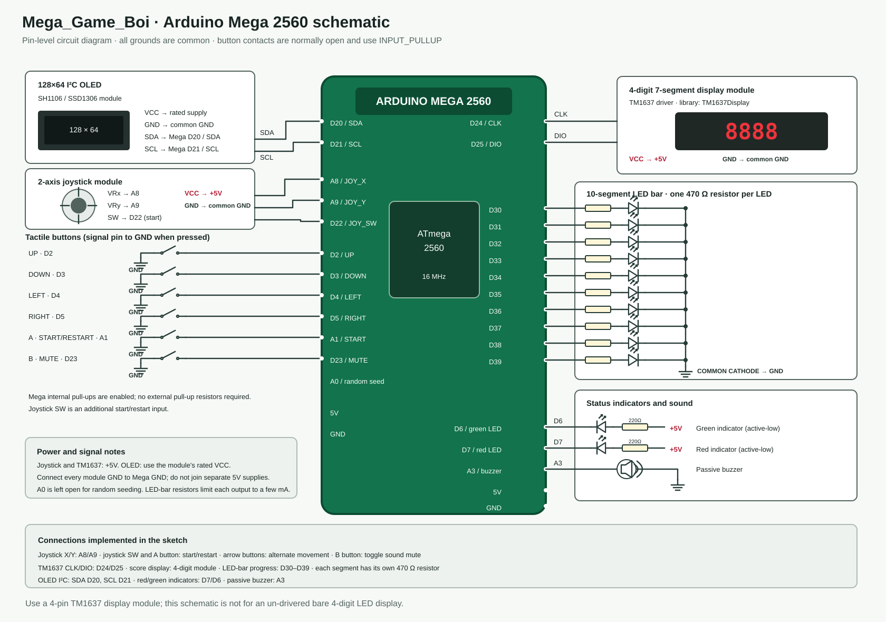

# Mega_Game_Boi


> [!NOTE]
> This project is almost entirely vibe coded. It's built off of my [Snake_Game](https://github.com/Sim3-14159/Snake_Game) repo.

Arduino Mega 2560 Snake with a two-axis joystick, tactile buttons, OLED, score display, LED bar, and passive buzzer.

Main sketch: [`Mega_Game_Boi.ino`](Mega_Game_Boi.ino)

## Mega 2560 circuit



This is a pin-level circuit schematic. The older [`images/schematic.svg`](images/schematic.svg) is the original Uno drawing; use the Mega schematic above for this build.

| Component | Mega 2560 pins / wiring |
|---|---|
| OLED SDA / SCL | D20/SDA / D21/SCL |
| OLED power | Module-rated 5V or 3.3V; common GND |
| Joystick X / Y | A8 / A9 |
| Joystick switch | D22 to GND; also starts/restarts |
| Up / down / left / right buttons | D2 / D3 / D4 / D5 to GND |
| A button | A1 to GND; start/restart |
| B button | D23 to GND; toggles sound mute |
| TM1637 4-digit display CLK / DIO | D24 / D25; VCC to 5V, GND to common GND |
| Ten-segment LED bar | D30–D39, each segment through its own 470 Ω resistor to the LED anode; common cathode to GND |
| Green / red status LEDs | D6 / D7 are active-low sinks; each LED anode goes through 220 Ω to +5V and its cathode goes to the pin |
| Passive buzzer | A3 to buzzer, other terminal to GND |
| Random seed input | Leave A0 unconnected |

The joystick moves the snake; the four direction buttons remain available and take priority when pressed. Buttons use `INPUT_PULLUP`, so each switch goes between its input pin and GND. The LED bar shows progress through each ten-food score interval, and the TM1637 display shows the exact score. All circuit grounds must join Mega GND.

**Display assumption:** the schematic and code use a four-pin TM1637 display module. A bare 12-pin four-digit display needs a separate driver circuit and is not wired the same way. Use a common-cathode LED bar (or ten separate LEDs) with one resistor per segment.

## Upload

1. Install the [U8g2 library](https://github.com/olikraus/u8g2) and the **TM1637** library by Avishay Orpaz (header: `TM1637Display.h`) in Arduino IDE. `Wire` and `EEPROM` come with the Arduino AVR board package.
2. Select **Tools → Board → Arduino AVR Boards → Arduino Mega or Mega 2560**.
3. Open `Mega_Game_Boi.ino`, select the Mega's port, then compile and upload.

The joystick is centered near 512 with a dead zone of 180 counts. If your joystick does not center reliably, adjust `JOYSTICK_CENTER` or `JOYSTICK_DEADZONE` in `CONFIG.h`. If up/down are reversed for your module, reverse the Y comparison in `readJoystick()`.

The sketch is configured for an SH1106 OLED. For an SSD1306, replace the SH1106 constructor in `Mega_Game_Boi.ino` with:

```cpp
U8G2_SSD1306_128X64_NONAME_F_HW_I2C u8g2(U8G2_R0, U8X8_PIN_NONE);
```
