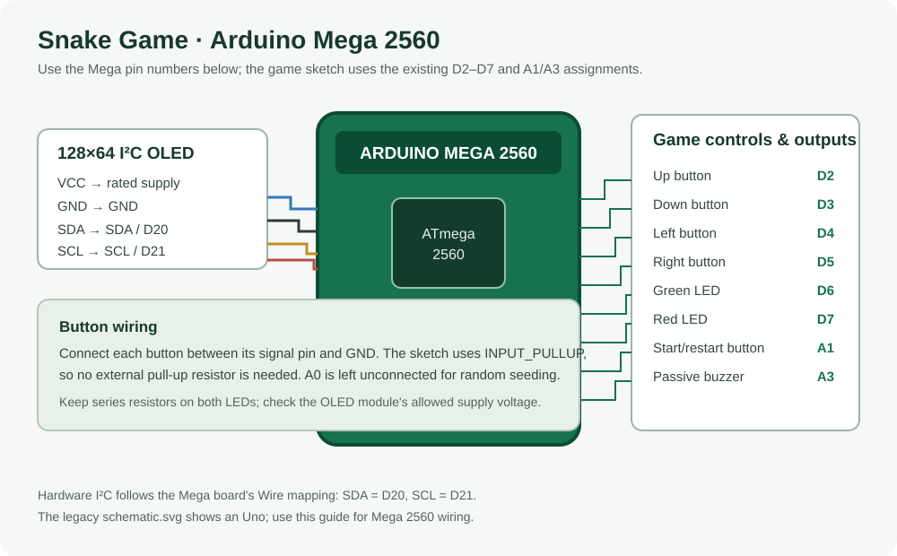

# Mega_Game_Boi

A fast-paced Arduino Snake game with an I²C OLED display, buttons, LEDs, and a passive buzzer. The sketch supports the **Arduino Mega 2560**; the existing pin assignments already work on that board.

Main sketch: [`Snake_Game.ino`](Snake_Game.ino)

## Arduino Mega 2560 wiring



| Part | Mega 2560 connection |
|---|---|
| Up button | D2 |
| Down button | D3 |
| Left button | D4 |
| Right button | D5 |
| Green LED | D6 |
| Red LED | D7 |
| Start/restart button | A1 |
| Passive buzzer | A3 |
| 128×64 I²C OLED SDA | SDA / D20 |
| 128×64 I²C OLED SCL | SCL / D21 |
| OLED power | 5V or 3.3V, according to the OLED module's rating |
| OLED ground | GND |

Each button connects its signal pin to GND when pressed. The sketch enables `INPUT_PULLUP`, so external pull-up resistors are not needed. Keep the current LED series resistors and buzzer wiring from your circuit. A0 is used as an unconnected analog input for the random seed.

The OLED uses hardware I²C through `Wire`; the board core selects the pins. On the Mega 2560, use **SDA/D20 and SCL/D21**—not the Uno's A4/A5 I²C pins. The older [`images/schematic.svg`](images/schematic.svg) depicts an Uno, so use the Mega guide above when wiring a Mega.

## Upload

1. Install the [U8g2 library](https://github.com/olikraus/u8g2) in the Arduino IDE. `Wire` and `EEPROM` are included with the Arduino AVR board package.
2. Select **Tools → Board → Arduino AVR Boards → Arduino Mega or Mega 2560**.
3. Open `Snake_Game.ino`, select the Mega's port, then compile and upload.

## Hardware

- Arduino Mega 2560
- 128×64 I²C monochrome OLED (SH1106 or SSD1306)
- Four direction buttons and one start/restart button
- Red and green LEDs with current-limiting resistors
- Passive buzzer

## Display driver

The sketch is configured for an SH1106 display. For an SSD1306, replace the SH1106 constructor in `Snake_Game.ino` with:

```cpp
U8G2_SSD1306_128X64_NONAME_F_HW_I2C u8g2(U8G2_R0, U8X8_PIN_NONE);
```

The Mega 2560 has enough RAM for the full-buffer U8g2 constructor used by default. Smaller boards with 2 KB or less of RAM may need a page-buffer constructor or may not have enough memory for the game.
